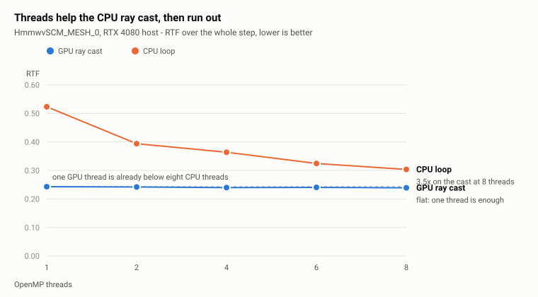
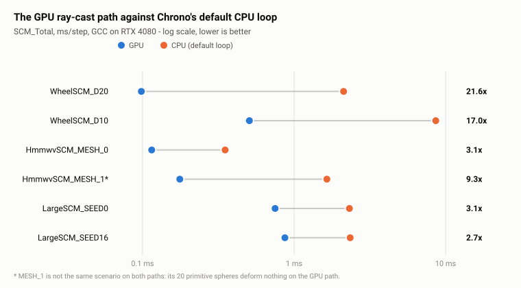
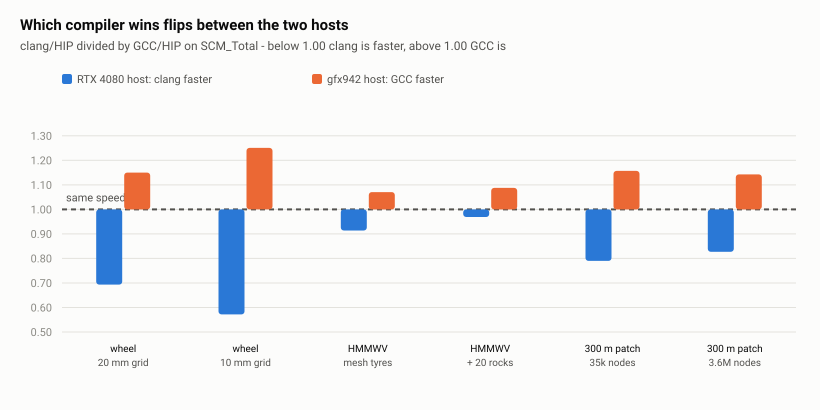
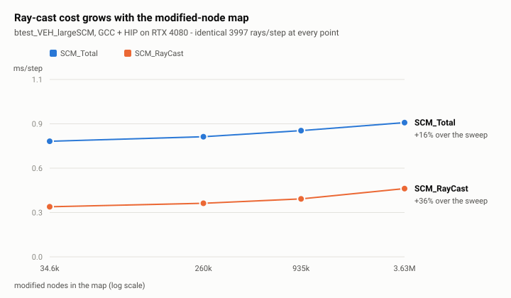
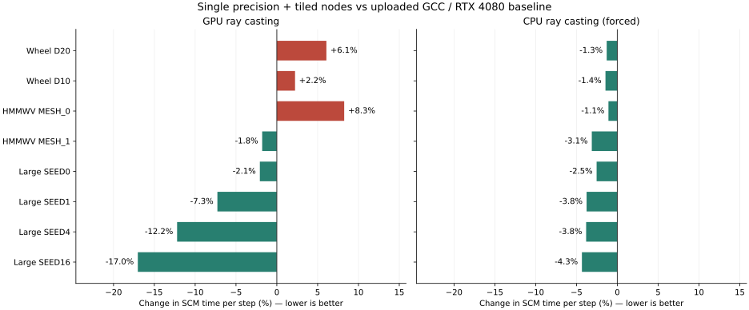
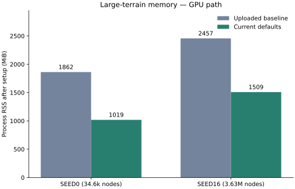

# SCM scaling benchmarks

Three benchmark programs covering the range SCM is used over, and a recorded baseline on NVIDIA and
AMD so a change to SCM can be judged without re-running everything on every platform.

| | test | vehicle | patch | grid spacing |
|---|---|---|---|---|
| small | `btest_VEH_wheelSCM` | one Polaris wheel on a test rig | 10 x 1 m | 0.02 / 0.01 m |
| medium | `btest_VEH_hmmwvSCM` | HMMWV, four wheels | 50 x 50 m | 0.05 m |
| large | `btest_VEH_largeSCM` | HMMWV, four wheels | 300 x 300 m | 0.02 m |

Each test has variants, and the tables below use their benchmark-suite names. What they mean:

| variant | what it changes | nodes deformed |
|---|---|---|
| `WheelSCM_D20` | 20 mm grid under the wheel | 1.7k |
| `WheelSCM_D10` | 10 mm grid -- four times as many nodes over the same ground | 7.2k |
| `HmmwvSCM_MESH_0` | four `RIGID_MESH` tyres, nothing else on the terrain | 5.4k |
| `HmmwvSCM_MESH_1` | the same, plus 20 scaled rock meshes dropped on the soil | 6.1k |
| `LargeSCM_SEED0` | no pre-worked ruts: only what the vehicle itself digs | 34.6k |
| `LargeSCM_SEED1` | 1 rut laid into the node map before the run | 260k |
| `LargeSCM_SEED4` | 4 ruts | 935k |
| `LargeSCM_SEED16` | 16 ruts | 3.63M |

The `SEED` number is how many pre-worked ruts are written into the modified-node map at setup, which
is how the large test reaches a map size that would otherwise take hours of driving. The number of
ruts is the only difference between them -- same vehicle, same patch, same route -- so the spread
across `SEED0` to `SEED16` is what map size alone costs.

`btest_VEH_hmmwvSCM` also registers `CYL_0` and `CYL_1`, the same runs with `RIGID` cylinder tyres.
They are not benchmarked here: the GPU ray-cast path accepts only triangle-mesh collision shapes, so
a cylinder tyre silently falls back to the CPU and the cell would not measure what its label claims.

## Real-time factor

RTF is execution time over simulated time, for the whole step -- vehicle dynamics, solver and
terrain -- so it is the figure a human-in-the-loop or hardware-in-the-loop run has to meet. Below 1
is real time. RTX 4080, GCC, 4 OpenMP threads.

| variant | simulated | RTF, GPU path | RTF, CPU loop |
|---|---|---|---|
| `WheelSCM_D20` | 3.0 s | **0.80** | 10.93 |
| `WheelSCM_D10` | 3.0 s | 2.90 | 43.57 |
| `HmmwvSCM_MESH_0` | 4.0 s | **0.24** | **0.36** |
| `HmmwvSCM_MESH_1` | 4.0 s | **0.39** | **0.82** |
| `LargeSCM_SEED0` | 4.0 s | **0.45** | 1.23 |
| `LargeSCM_SEED16` | 4.0 s | **0.53** | 1.25 |

`HmmwvSCM` is the configuration used to assess the 2023 SCM redesign -- a 50 x 50 m patch at 0.05 m
spacing under a full HMMWV ([Serban, Taves and Zhou, *J. Comput. Nonlinear Dyn.* 18(8):081007,
2023](https://doi.org/10.1115/1.4056851), sec. 3.1). That paper reports RTF 4.03 for the mesh-based
implementation that preceded it, and sub-1 for the redesign it introduced. `MESH_0` here puts the
current implementation at 0.36 on a newer host, and the GPU ray-cast path at 0.24 -- close to the
0.3 that paper quotes for the same vehicle on *rigid* terrain, which is the point at which
terramechanics stops being the bottleneck.

Read the wheel rows against their step size rather than against the others: the rig integrates at
2e-4 s, five times finer than the vehicle tests, so 5000 steps buy one simulated second. `D10` at
2.90 is not a real-time result and is not meant to be one.

## Strong scaling of the ray cast

SCM parallelizes ray casting across OpenMP threads, so how far that scales decides how much of a
host the terrain needs. `HmmwvSCM_MESH_0`, RTX 4080 host, GCC, 3 repetitions per cell.

| threads | `SCM_RayCast` CPU | speedup | `SCM_RayCast` GPU | RTF CPU | RTF GPU |
|---|---|---|---|---|---|
| 1 | 0.6143 | 1.00x | 0.0662 | 0.523 | 0.243 |
| 2 | 0.3529 | 1.74x | 0.0630 | 0.394 | 0.242 |
| 4 | 0.2951 | 2.08x | 0.0628 | 0.364 | 0.240 |
| 6 | 0.2167 | 2.83x | 0.0623 | 0.324 | 0.241 |
| 8 | 0.1754 | 3.50x | 0.0625 | 0.304 | 0.239 |

<picture>
  <source media="(prefers-color-scheme: dark)" srcset="img/scm-threads-dark.svg">
  
</picture>

Three things follow.

**The CPU cast scales, but not well.** 3.50x on eight threads is 44% parallel efficiency. Fitting
Amdahl to that puts the serial fraction at 0.18, which caps the cast at 5.45x however many cores are
added -- 0.113 ms/step. The GPU cast already runs at 0.0625, so it sits a factor of 1.8 beyond the
limit of the threaded implementation rather than merely ahead of its current thread count.

**The GPU path does not care about threads at all.** 0.0662 to 0.0625 across the sweep: the cast is
off the CPU, and what remains around it is not the part that parallelizes.

**One thread on the GPU path beats eight on the CPU loop** -- RTF 0.243 against 0.304. The seven
threads that buys back are available to the rest of the simulation, which is the argument for the
GPU path on a host doing anything else at the same time.

## What the baseline shows

**1. The GPU ray-cast path costs 2.7x to 22x less than Chrono's default CPU loop** on
`SCM_Total`, the end-to-end cost of one SCM step.

<picture>
  <source media="(prefers-color-scheme: dark)" srcset="img/scm-gpu-vs-cpu-dark.svg">
  
</picture>

**2. The host compiler moves `SCM_Total`, and which compiler wins depends on the platform.** On the
RTX 4080 clang beats GCC by up to 43%; on gfx942 GCC beats clang on all six GPU cells by 7-25%. The
kernel is not what moves -- it is device code, identical in both builds -- so this is the host-side
SCM work around it, and it means a compiler chosen on one platform's numbers is the wrong choice on
the other.

Each bar below is `clang/HIP` divided by `GCC/HIP` on one host, at identical deformed-node counts.
1.00 means the two builds are identical, below 1.00 means clang is faster, above means GCC is.

<picture>
  <source media="(prefers-color-scheme: dark)" srcset="img/scm-what-moves-it-dark.svg">
  
</picture>

**3. The two GPU backends are not distinguishable by these benchmarks.** Across all sixteen
CUDA/HIP pairs the largest gap in `SCM_Total` is 2.0%, and it favours neither -- eight cells above
parity, eight below. That is smaller than this suite's own run-to-run spread, where repeated
processes of `WheelSCM_D20` on one build differ by as much as 10%. `SCM_Rays` and `SCM_Nodes` agree
to the digit on every variant, so the two are doing identical work. There is no chart for this:
sixteen ratios scattered about 1.00 would imply a structure the measurements do not support.

**4. Once the cast is on the GPU, the node work is the larger half of the step, and it grows with the
size of the modified-node map.** The cast is 79-94% of `SCM_Total` on the CPU loop and 20-55% of it
on the GPU path, so what is left to win is no longer in the cast. Ray count is 3997.2 per step at
every point below, so the growth there is map size alone: `GetHeight()` is called once per candidate
node per step and probes a map that only ever grows. This is what a tiled or narrower node store
would remove, and `btest_VEH_largeSCM` exists to measure it.

<picture>
  <source media="(prefers-color-scheme: dark)" srcset="img/scm-scaling-dark.svg">
  
</picture>

# Single precision and tiled nodes

Updated 2026-10-17 on `scm-fp32-and-index-overflow`, compared with the uploaded
`feature/scm-benchmarks` report at `3959a70eefe97f056442799b7e53d78346ba7dfb`.
The original NVIDIA and AMD baseline tables below are retained for reference.

This branch defaults to single precision for soil-node state and base heights, and a sparse
16 x 16 tiled node map. The two storage choices are independent Chrono build options:

```bash
cmake -S . -B build -DCH_ENABLE_MODULE_VEHICLE=ON \
  -DCH_VEHICLE_SCM_USE_DOUBLE=OFF \
  -DCH_VEHICLE_SCM_USE_TILED_NODES=ON
cmake --build build
```

Use `CH_VEHICLE_SCM_USE_DOUBLE=ON` for double storage or
`CH_VEHICLE_SCM_USE_TILED_NODES=OFF` for the original flat hash map. Rebuild Chrono and its
clients after changing either option. Public terrain APIs still use doubles; these options
do not change GPU kernel arithmetic.

## Trends

**Tiling pays off as the modified-node map grows and cache pressure increases.** Large GPU
cases improve by 2-17%, with the largest gain at 3.63M stored nodes. GPU SCM cost now stays
near 0.72-0.73 ms/step from `SEED0` to `SEED16`; the uploaded flat-map baseline grew from
0.7493 to 0.8702 ms/step, about 16%. Tiling keeps neighbouring node accesses together as
more ground is covered.

**Single precision reduces the terrain footprint.** The dense base-height field uses four
bytes per entry instead of eight. Total GPU-process setup RSS falls by 39-45% on the large
terrain, and the memory added by the seeded nodes falls by about 18%.

**Small maps can pay tile lookup overhead without gaining much locality.** When the working
set already fits in cache, the extra tile lookup can cost more than it saves. Three small GPU
cases are 2-8% slower here; `MESH_1` is about 2% faster. The flat-map toggle lets applications
choose that tradeoff, while single precision remains useful for reducing storage. CPU SCM
time improves by about 1-4% across the eight cases.



## SCM time per step

GCC / RTX 4080, four OpenMP threads. Negative percentages mean less time. `SCM_Total`
includes all SCM phases, not just the ray cast.

| Variant | Uploaded GPU ms | FP32/tiled GPU ms | Change | Uploaded CPU ms | FP32/tiled CPU ms | Change |
|---|---:|---:|---:|---:|---:|---:|
| `WheelSCM_D20` | 0.0982 | 0.1042 | +6.1% | 2.1204 | 2.0928 | -1.3% |
| `WheelSCM_D10` | 0.5070 | 0.5183 | +2.2% | 8.6116 | 8.4867 | -1.4% |
| `HmmwvSCM_MESH_0` | 0.1149 | 0.1244 | +8.3% | 0.3506 | 0.3468 | -1.1% |
| `HmmwvSCM_MESH_1` | 0.3625 | 0.3560 | -1.8% | 1.2149 | 1.1769 | -3.1% |
| `LargeSCM_SEED0` | 0.7493 | 0.7337 | -2.1% | 2.3183 | 2.2595 | -2.5% |
| `LargeSCM_SEED1` | 0.7786 | 0.7219 | -7.3% | 2.3377 | 2.2497 | -3.8% |
| `LargeSCM_SEED4` | 0.8182 | 0.7183 | -12.2% | 2.3303 | 2.2413 | -3.8% |
| `LargeSCM_SEED16` | 0.8702 | 0.7221 | -17.0% | 2.3447 | 2.2430 | -4.3% |

## Large terrain memory

GPU path, process resident set after setup. RSS includes the terrain, libraries, runtime
and allocator state; it is not peak memory.

| Variant | Uploaded MiB | FP32/tiled MiB | Change |
|---|---:|---:|---:|
| `LargeSCM_SEED0` | 1862.1 | 1018.5 | -45.3% |
| `LargeSCM_SEED16` | 2457.0 | 1508.8 | -38.6% |

Adding about 3.60M seeded nodes increases setup RSS by 490.3 MiB, versus 594.9 MiB uploaded
(-17.6%). The ruts are 15 nodes wide and cross tile boundaries, so partly filled tiles are
included in this measurement.



## Whole-simulation real-time factor

RTF is wall time divided by simulated time, including vehicle dynamics and the solver.
Below 1 is real time. The two intermediate seed cases have no uploaded RTF value.

| Variant | Uploaded GPU | FP32/tiled GPU | Uploaded CPU | FP32/tiled CPU |
|---|---:|---:|---:|---:|
| `WheelSCM_D20` | 0.800 | 0.854 | 10.930 | 10.823 |
| `WheelSCM_D10` | 2.900 | 2.985 | 43.570 | 42.969 |
| `HmmwvSCM_MESH_0` | 0.240 | 0.248 | 0.360 | 0.360 |
| `HmmwvSCM_MESH_1` | 0.390 | 0.388 | 0.820 | 0.797 |
| `LargeSCM_SEED0` | 0.450 | 0.438 | 1.230 | 1.202 |
| `LargeSCM_SEED1` | - | 0.432 | - | 1.197 |
| `LargeSCM_SEED4` | - | 0.429 | - | 1.193 |
| `LargeSCM_SEED16` | 0.530 | 0.431 | 1.250 | 1.193 |

## Thread scaling

`HmmwvSCM_MESH_0`. GPU execution remains almost independent of the OpenMP thread count;
CPU ray casting continues to benefit from more threads.

| Threads | Uploaded CPU cast ms | FP32/tiled CPU cast ms | Uploaded GPU cast ms | FP32/tiled GPU cast ms | FP32/tiled CPU RTF | FP32/tiled GPU RTF |
|---:|---:|---:|---:|---:|---:|---:|
| 1 | 0.6143 | 0.6093 | 0.0662 | 0.0707 | 0.517 | 0.247 |
| 2 | 0.3529 | 0.3422 | 0.0630 | 0.0698 | 0.388 | 0.246 |
| 4 | 0.2951 | 0.2876 | 0.0628 | 0.0703 | 0.360 | 0.248 |
| 6 | 0.2167 | 0.2141 | 0.0623 | 0.0697 | 0.322 | 0.248 |
| 8 | 0.1754 | 0.1726 | 0.0625 | 0.0697 | 0.302 | 0.249 |

## Measurement setup and data

- Same i7-13700K / RTX 4080 host as the uploaded NVIDIA baseline: 24 logical CPUs,
  30 MiB L3, 62 GiB RAM. GCC 11.4.0, Release `-O3 -march=native`, ROCm 7.2.4 HIP on
  NVIDIA over CUDA 13.2.78. GPU kernel arithmetic explicitly FP32.
- Each variant ran in a fresh process with an anchored filter. GPU cells average two
  processes; CPU cells use one. Each process has the fixture's 5 or 10 internal repetitions.
  All 32 processes completed successfully; no builds or tests ran concurrently.
- GPU runs used `SCM_BENCH_RAYCAST=gpu CHRONO_SCM_FORCE_CPU=0`; CPU runs used
  `SCM_BENCH_RAYCAST=cpu CHRONO_SCM_FORCE_CPU=1`. Backend banners and populated counters
  were checked. CPU/GPU paths retain their own ray and node counts.
- Worst internal `SCM_Total` CV was 2.61%; GPU process-mean spreads were at most 1.43%.
  Thread-scaling cells use 10 internal repetitions; the uploaded sweep used 3.
- Setup RSS is the median completed-repetition sample per process, averaged across the
  two GPU processes. One variant per process prevents retention from other variants
  inflating the comparison.
- The uploaded report notes the upstream wheel-rig refactor and a few percent of wheel
  timing variation. These are comparisons with that historical report. AMD and Clang
  baseline columns below have not been refreshed.

[Main comparison CSV](results/scm-fp32-tiled-rtx4080.csv) includes SCM and ray-cast timers,
RTF, node counts, memory, repetition counts and variation.
[Thread-scaling CSV](results/scm-fp32-tiled-rtx4080-scaling.csv) contains the full sweep.

# Baseline -- RTX 4080

i7-13700K (16 cores / 24 threads, 30 MiB L3), 62 GB. Release, `-O3 -march=native`, Chrono OpenMP
threads 4, container `atk/chrono:orb`. GCC 11.4.0 and AMD clang 22.0 (ships with ROCm 7.2.4).
CUDA 13.2.78; the HIP columns are ROCm 7.2.4 with `CMAKE_HIP_PLATFORM=nvidia`, over that same
toolkit. Both GPU backends are built from the same kernel sources.

GPU cells are the mean of 2 processes, `ref` and CPU of 1, each itself Google Benchmark's mean over
5 or 10 internal repetitions. Worst internal cv on `SCM_Total` was 3.21% (clang/CPU `MESH_0`); every
other cell was under 2%.

## `SCM_Total`, ms/step

| variant | GCC/CUDA | GCC/HIP | clang/CUDA | clang/HIP | GCC/ref | GCC/CPU | clang/CPU |
|---|---|---|---|---|---|---|---|
| `WheelSCM_D20` | 0.0971 | 0.0982 | 0.0694 | 0.0681 | 6.8687 | 2.1204 | 2.1706 |
| `WheelSCM_D10` | 0.5046 | 0.5070 | 0.2897 | 0.2899 | - | 8.6116 | 8.2832 |
| `HmmwvSCM_MESH_0` | 0.1152 | 0.1149 | 0.1063 | 0.1050 | 6.1585 | 0.3506 | 0.4024 |
| `HmmwvSCM_MESH_1` | 0.3579 | 0.3625 | 0.3487 | 0.3513 | 44.6546 | 1.2149 | 1.4578 |
| `LargeSCM_SEED0` | 0.7514 | 0.7493 | 0.6008 | 0.5918 | 34.3628 | 2.3183 | 2.2628 |
| `LargeSCM_SEED1` | 0.7891 | 0.7786 | 0.6425 | 0.6298 | - | 2.3377 | 2.3180 |
| `LargeSCM_SEED4` | 0.8075 | 0.8182 | 0.6408 | 0.6332 | - | 2.3303 | 2.3086 |
| `LargeSCM_SEED16` | 0.8704 | 0.8702 | 0.7264 | 0.7198 | 34.5411 | 2.3447 | 2.3022 |

## Memory -- resident set after setup, MiB

| build | `SEED0` | `SEED16` | delta |
|---|---|---|---|
| GCC, either backend | 1862.1 | 2457.0 | 594.9 |
| clang/HIP | 1864.1 | 2458.9 | 594.9 |
| clang/CUDA | 2085.1 | 2680.0 | 594.8 |

The delta is what 3.60M added nodes cost: 165 B/node, against a 128-byte `NodeRecord` plus
`unordered_map` overhead and allocator rounding. It is the same in every build; only the constant
offset moves, and most of that offset is the base-height matrix -- 15001^2 entries at 8 bytes is
1716.8 MiB.

# Baseline -- gfx942 (MI300X)

EPYC 9684X, 16-core slice, 233 GB. ROCm 7.2.4, HIP backend, GCC 11.4.0 and ROCm clang 22.0.0git.
Release, benchmarks set 4 Chrono OpenMP threads internally. All cv <= 0.18%. One process per cell.

`SCM_Total` in ms/step. The `MESH_1` row was measured at `1753904fd` and the rest of the grid at
`7c0d0ea20`; the only change to the other tests in between adds the backend selector and no physics.

| variant | GCC/HIP | GCC/CPU | clang/HIP | clang/CPU |
|---|---|---|---|---|
| `WheelSCM_D20` | 0.1726 | 3.3830 | 0.1985 | 3.4522 |
| `WheelSCM_D10` | 0.6863 | 13.8749 | 0.8582 | 13.7305 |
| `HmmwvSCM_MESH_0` | 0.2214 | 0.7856 | 0.2370 | 0.6313 |
| `HmmwvSCM_MESH_1` | 0.5178 | 2.1898 | 0.5631 | 2.2433 |
| `LargeSCM_SEED0` | 1.1186 | 3.5594 | 1.2941 | 4.7062 |
| `LargeSCM_SEED16` | 1.3809 | 4.7167 | 1.5779 | 4.8605 |

Resident set after setup, MiB: `SEED0` 2366 GPU / 1745 CPU, `SEED16` 2961 GPU / 2340 CPU. The
595 MiB node-storage delta matches the NVIDIA host exactly; the GPU builds carry ~620 MiB more
constant offset than the CPU-only builds.

Deformed-node counts agree with the RTX 4080 host to the digit on every variant except `MESH_1`,
where the two hosts span 6106 to 6155 -- 0.8%, and the residual is between the two gfx942 GPU cells
rather than between the paths. The two platforms ran the same work and the columns are directly
comparable.

## The two hosts side by side

`SCM_Total` in ms/step, GCC on both, so the only variable is the machine:

| variant | GPU 4080 | GPU gfx942 | CPU 4080 | CPU gfx942 |
|---|---|---|---|---|
| `D20` | 0.0982 | 0.1726 | 2.1204 | 3.3830 |
| `D10` | 0.5070 | 0.6863 | 8.6116 | 13.8749 |
| `MESH_0` | 0.1149 | 0.2214 | 0.3506 | 0.7856 |
| `MESH_1` | 0.3625 | 0.5178 | 1.2149 | 2.1898 |
| `SEED0` | 0.7493 | 1.1186 | 2.3183 | 3.5594 |
| `SEED16` | 0.8702 | 1.3809 | 2.3447 | 4.7167 |

The 4080 is ahead everywhere: 1.4-1.9x on the GPU path, 1.5-2.2x on the CPU path. That is the
expected shape rather than a surprise. These are small kernels -- a few hundred to a few thousand
rays per step -- where a high-clocked consumer part beats a datacenter GPU built for wide parallel
work, and a shared 16-core EPYC slice loses to a 5.3 GHz Raptor Lake on a four-thread CPU path.

# Caveats

- **Primitive-shaped bodies get no contact force on the GPU path.** The GPU backend intersects
  triangle meshes only: a primitive collision shape contributes no faces, never appears as a hit's
  contactable, and receives nothing back from the soil. It falls through the terrain. The bail-out
  in `ComputeRayCastGpuHip` fires only when *no* candidate carries a mesh, so a mixed scene keeps
  the GPU path and silently drops its primitives. This is why `MESH_1`'s obstacles are rock meshes:
  as spheres they fell through, and the variant timed a scene its obstacles were absent from. The
  defect is in the backend, not the benchmark, and is unfixed.

- **`D20` and `D10` deform 1.41x and 1.31x more nodes on the CPU loop than on the GPU path.** Not
  the above -- the wheel rig has no primitive collidables -- and not the footprint cull, since `ref`
  applies no cull and matches the GPU node count exactly. Unexplained. Everywhere else the paths
  agree: `MESH_0` 1.01x, `MESH_1` 1.00x, `SEED16` 1.00x.

- **`ref` carries no speedup claim.** It reproduces the GPU path's physics on the CPU, which is what
  makes the node-count agreement meaningful, but it is a validation aid and runs several times
  slower than the production CPU loop. `D10` has no `ref` cell: ~50 min for a column that compares
  nothing.

- **Total step time is not a measure of SCM work.** In the wheel test the constraint solver is a
  third of it. Every figure here is `SCM_Total`, not wall-clock per step.

- **One machine per platform.** L3 size is implicated in every CPU-path figure, and the AMD host is
  a shared slice.

- **The tables were taken at `1753904fd`, before `ChWheelTestRig` was refactored upstream.** A spot
  check after that refactor left `SCM_Nodes` and `SCM_Rays` identical to the digit on both wheel
  variants, so the scene is unchanged, and put `SCM_Total` about 3% above these figures on each --
  inside the 10% spread that repeated `D20` processes show on this host. Treat the wheel rows as
  good to a few percent rather than to the last digit.

# Reproducing

    cmake -S . -B build -G Ninja -DCMAKE_BUILD_TYPE=Release \
      -DCH_ENABLE_MODULE_VEHICLE=ON -DCH_ENABLE_MODULE_VEHICLE_MODELS=ON \
      -DBUILD_BENCHMARKING=ON -DBUILD_DEMOS=OFF -DBUILD_TESTING=OFF
    cmake --build build -j --target btest_VEH_wheelSCM btest_VEH_hmmwvSCM btest_VEH_largeSCM

- Run from `build/bin`; Chrono resolves its data by relative path.
- `SCM_BENCH_RAYCAST=gpu|ref|cpu` picks the path, `gpu` by default. **Every run prints which one it
  got. Check that line.** A binary older than this variable ignores it silently and reports `gpu`,
  which is how a whole grid of "CPU" numbers can turn out to be GPU runs.
- One variant per process, and **anchor the filter**: `--benchmark_filter=SEED1/` matches only
  `SEED1`, where `SEED1` also matches `SEED16`. Google Benchmark rebuilds the fixture between
  repetitions and glibc does not return the freed matrix to the OS, so a combined run reports
  allocator retention as live data.
- Nothing else on the machine. A concurrent build moves these numbers by more than the effects they
  are meant to catch.
- `ScmBenchmarkUtils.h` also reports `SCM_Rays`, and it does not compare across paths: the GPU path
  discards nodes outside every mesh body's XY footprint before counting
  ([`SCMTerrainRaycastGpu.cpp`](../../../chrono_vehicle/terrain/SCMTerrainRaycastGpu.cpp), the
  `in_footprint` test) and the CPU loop does not, so the same hits are found from different ray
  counts -- 363 against 1682 on `D20`. Compare `SCM_Nodes`.
- Do not add an active domain to the wheel test. `ChWheelTestRig::CreateTerrainSCM` already declares
  one; a second casts the nodes under the wheel once per domain and inflates `SCM_Rays` without
  changing any physics.

# Why the large test is built the way it is

The modified-node map only grows -- a node enters on first contact and is never evicted -- so in a
long run its size reflects ground covered, not ground under a wheel; a 13.7 h two-rover run reached
~891k entries. Seeding gets there in under a second and isolates map size from how it got large.
The patch comes from a height map rather than `Initialize(sizeX, sizeY, delta)` because a flat patch
allocates no base-height matrix at all and so cannot measure one. Seeded ruts are 15 nodes wide at
rows 2003 + 114k: neither offset nor pitch is a power of two, so no storage scheme is flattered by
the layout.

# Appendix -- the `SCM_RayCast` sub-timer

Recorded for regression triage only, so a future slowdown can be placed in the cast or in the node
work around it. It carries no result of its own: the cast alone does not produce a deformed terrain,
and the numbers to compare against are the `SCM_Total` tables above.

RTX 4080, ms/step:

| variant | GCC/CUDA | GCC/HIP | clang/CUDA | clang/HIP | GCC/ref | GCC/CPU | clang/CPU |
|---|---|---|---|---|---|---|---|
| `WheelSCM_D20` | 0.0359 | 0.0370 | 0.0365 | 0.0352 | 6.7994 | 1.9911 | 2.0941 |
| `WheelSCM_D10` | 0.0978 | 0.1000 | 0.0975 | 0.0975 | - | 7.7662 | 7.8633 |
| `HmmwvSCM_MESH_0` | 0.0628 | 0.0629 | 0.0635 | 0.0634 | 6.0965 | 0.2925 | 0.3513 |
| `HmmwvSCM_MESH_1` | 0.1913 | 0.1942 | 0.1911 | 0.1923 | 44.4682 | 1.0325 | 1.2762 |
| `LargeSCM_SEED0` | 0.3260 | 0.3248 | 0.3288 | 0.3261 | 33.9085 | 1.8237 | 1.9392 |
| `LargeSCM_SEED1` | 0.3516 | 0.3473 | 0.3615 | 0.3537 | - | 1.8418 | 1.9865 |
| `LargeSCM_SEED4` | 0.3669 | 0.3757 | 0.3641 | 0.3611 | - | 1.8351 | 1.9833 |
| `LargeSCM_SEED16` | 0.4431 | 0.4427 | 0.4524 | 0.4516 | 34.0860 | 1.8498 | 1.9782 |

gfx942, ms/step:

| variant | GCC/HIP | GCC/CPU | clang/HIP | clang/CPU |
|---|---|---|---|---|
| `WheelSCM_D20` | 0.0939 | 3.1726 | 0.0971 | 3.2355 |
| `WheelSCM_D10` | 0.1882 | 12.6312 | 0.2036 | 12.4352 |
| `HmmwvSCM_MESH_0` | 0.1464 | 0.6282 | 0.1501 | 0.5076 |
| `HmmwvSCM_MESH_1` | 0.2998 | 1.8277 | 0.3105 | 1.8714 |
| `LargeSCM_SEED0` | 0.5670 | 2.8957 | 0.5868 | 3.4875 |
| `LargeSCM_SEED16` | 0.8256 | 3.6066 | 0.8656 | 3.6381 |
